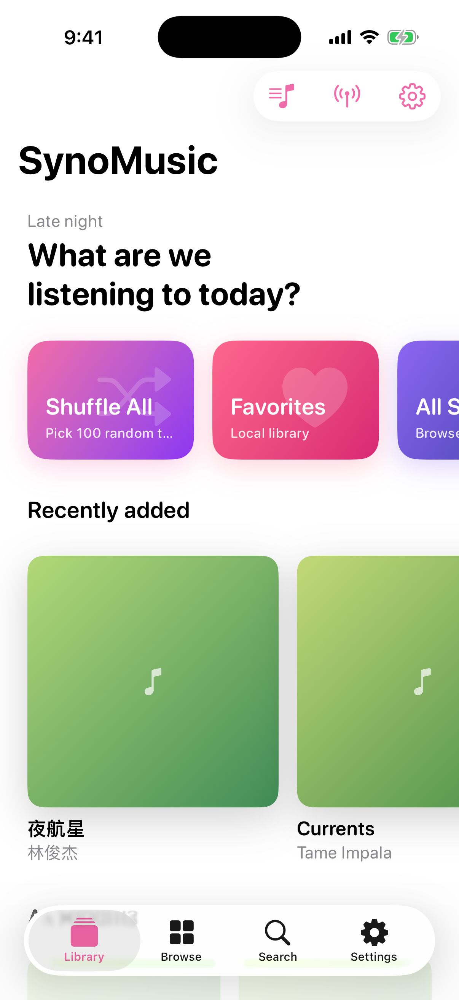
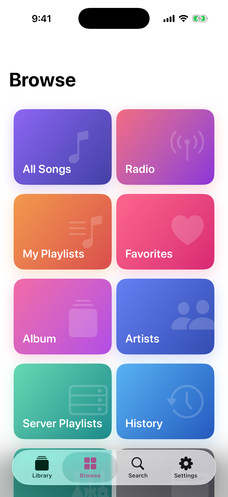
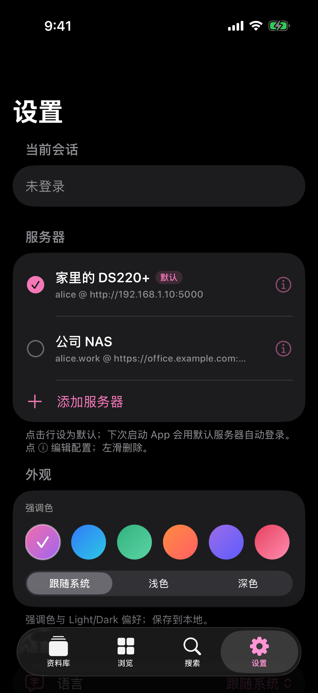
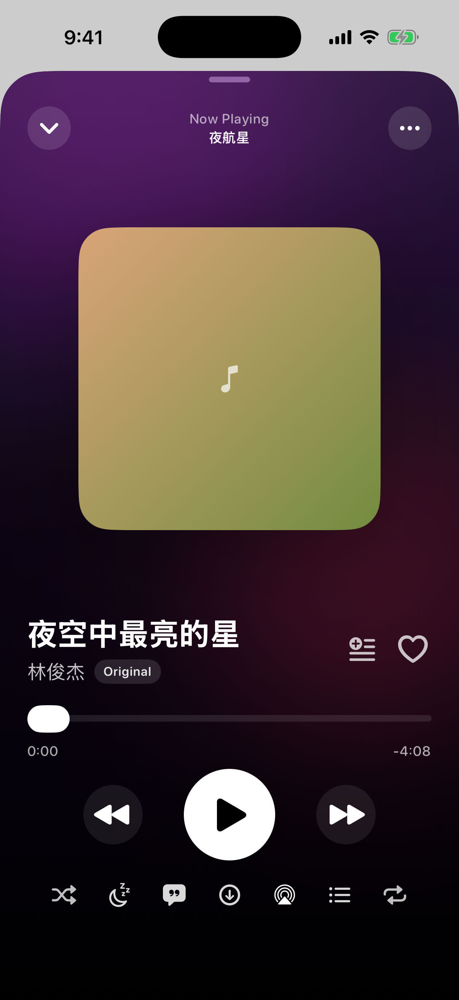
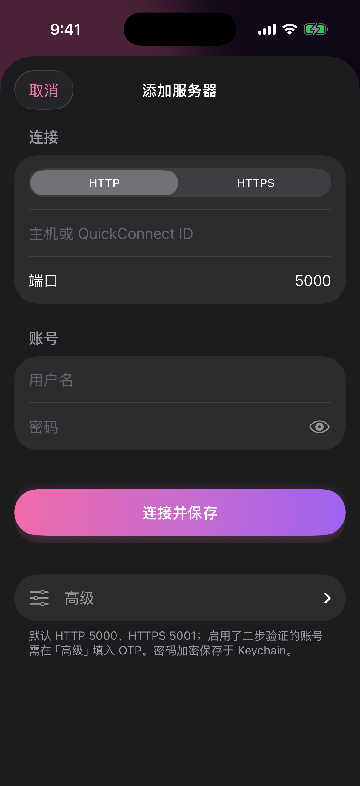

# SynoMusic

> 一个为自托管音乐库打造的、漂亮的 iOS 原生音乐客户端。

[English](README.md) · [简体中文](README.zh.md) · [日本語](README.ja.md) · [한국어](README.ko.md)

[在 App Store 下载](https://apps.apple.com/us/app/synomusic/id6784094020) · [官网](https://zanwingmak.github.io/SynoMusic-OpenSource/) · [最新版本](https://github.com/ZanwingMak/SynoMusic-OpenSource/releases/latest)

SynoMusic 为个人音乐库提供干净流畅的 iOS 原生体验：浏览、搜索、播放、本地多歌单收藏、全球电台、锁屏与灵动岛全控制。商业 App Store 版本面向多种音乐源，包括 Synology Audio Station、Plex、Jellyfin、Emby、WebDAV、SMB 和本地文件。

## 开源版说明

这个仓库包含 SynoMusic iOS App 的开源代码，包括主 App、灵动岛 / Live Activity 扩展、本地歌单与下载存储、Synology Audio Station API 客户端，以及 GitHub Pages 官网。GitHub Pages 同时作为商业 App Store 版本的营销官网、服务条款、隐私政策和反馈入口；商店版私有功能代码不会同步到这里。

- 你需要准备自己的音乐服务器、账号、媒体文件和访问权限；仓库不包含演示服务器、代理服务或任何内置账号。
- 开源代码目前以 Synology Audio Station 为主；App Store 版本可能包含 Plex、Jellyfin、Emby、WebDAV、SMB、本地导入、订阅和审核模式等额外私有实现。
- Release IPA 只是为了方便安装；如果从源码构建，需要在 Xcode 中使用你自己的 Apple 开发者签名。
- 账号凭证保存在 iOS Keychain，下载歌曲保存在 App 沙盒内。
- 仓库截图和示例使用的是脱敏示例数据，请不要提交真实服务器地址、QuickConnect ID、Plex Token、WebDAV/SMB 路径或账号信息。

## 截图

|  资料库  |  浏览  |  设置  |
| :---: | :---: | :---: |
|  |  |  |

|  全屏播放器  |  服务器编辑  |
| :---: | :---: |
|  |  |

## 最新版本：1.3.5

- 修复播放中被其他 App 媒体中断后，播放按钮状态不准确的问题。
- 修复其他 App 媒体结束后，SynoMusic 未按中断前状态自动恢复播放的问题。
- 完整更新见 [`CHANGELOG.md`](CHANGELOG.md)。

## 功能

- **自托管优先**：多服务器档案、Keychain 凭证、双重验证（OTP）、自签名证书信任、HTTPS / QuickConnect（取决于音乐源支持）
- **流式播放**：AVQueuePlayer、原始流失败自动 MP3 转码兜底、AirPlay、CarPlay 远程命令
- **资料库**：专辑、艺术家、流派、文件夹、服务器歌单、*所有歌曲*（分页 + 排序）
- **本地歌单**：多个自定义收藏夹、内置「我喜欢的」、批量编辑、多选添加
- **电台**：30,000+ 全球电台（Radio-Browser API），按国家/标签/搜索
- **播放器**：全屏播放器、同步歌词、队列编辑、定时停止（预设 / 自定义 / 时间点）、点封面 ↔ 歌词切换
- **系统集成**：锁屏 Now Playing、灵动岛 Live Activity（compact / minimal / expanded）、Remote Command
- **主题**：8 种强调色 + 跟随系统 / 浅色 / 深色
- **多语言**：简体中文、繁體中文、English、日本語、한국어、Deutsch、Français
- **离线**：歌曲下载到沙盒

## 系统要求

- **iOS 17** 及更新
- 从源码构建需要 **Xcode 26** 或更新
- 本开源构建需要群晖 NAS，已安装 **Audio Station** 并给目标账号开启 Audio Station 权限
- 灵动岛：iPhone 14 Pro 及更新

## 从源代码构建

仓库中的 Xcode 工程由 [`project.yml`](project.yml) 通过 [XcodeGen](https://github.com/yonaskolb/XcodeGen) 生成。修改工程结构、Target、构建配置或资源后，请重新生成工程。

```bash
brew install xcodegen
git clone https://github.com/ZanwingMak/SynoMusic-OpenSource.git
cd SynoMusic-OpenSource
xcodegen generate
open SynoMusic.xcodeproj
```

在 Xcode → Signing & Capabilities 中为 `SynoMusic` 和 `SynoMusicLive` 设置你自己的开发者签名后即可在模拟器或真机运行。

## 赞助

- **PayPal** — [paypal.me/zanwing](https://paypal.me/zanwing)
- **Buy Me a Coffee** — [buymeacoffee.com/zanwing](https://buymeacoffee.com/zanwing)
- **Wise** — [wise.com/pay/me/zhenyingm1](https://wise.com/pay/me/zhenyingm1)
- **微信 / 支付宝** — 在设置 → 赞助支持中扫码

## 协议

本项目采用 **GNU GPL v3.0** 协议。详见 [`LICENSE`](LICENSE)。

> SynoMusic 是个人音乐源的非官方客户端。*Synology*、*DSM*、*Audio Station*、*Plex*、*Jellyfin*、*Emby* 等名称归各自所有者所有。
